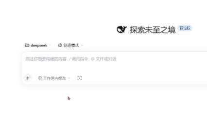

# dsh-screenshot

给 [DeepSeek Harness](https://github.com/deepseek-ai/deepseek-harness) Web UI 用的截图插件：点一下按钮，浏览器窗口先隐藏，
在真实桌面上拖框选区，窗口自动回来，PNG 作为**待发送附件**落进输入框草稿。你不按回车，它就不会发出去。

[English](README.md) | 中文



> **平台：** 仅 Windows 10/11。隐藏窗口和抓屏都是 Win32 调用，其它平台需要另写原生后端。

## 为什么做这个

给"你正在聊天的这个窗口"截图一直很别扭：任何截图工具都会把聊天窗口本身也拍进去。这个插件先把自己的窗口藏起来，
所以你框住的是它背后的桌面——你在描述的那个模型、那个报错对话框、那个算错的表格单元格。

## 用法

1. 鼠标移到输入框左侧工具行的截图图标上（和模型选择同一行），停一下会弹出一个小面板，两个选项二选一；
   也可以直接点图标，用上次选的那个模式：
   - **隐藏窗口后截图**（默认）—— 浏览器窗口先让开，你截的是它背后的桌面
   - **保持窗口截图** —— 直接截当前画面，包含本窗口
2. 屏幕上出现冻结画面 + 全屏选区遮罩
3. 按住左键拖一个矩形，**松手后选区留在原地**，右下角出现小工具栏：矩形、箭头、撤销、确认、取消
4. 在选区内画矩形和箭头，`Ctrl+Z` 撤销上一笔
5. 点 ✓（或按 `Enter`）完成；点 ✕（或按 `Esc`）取消
6. 隐藏模式下窗口自动回到前台；两种模式结果都是以缩略图出现在输入框上方
7. 补上你的问题，按回车发送

helper 在 `finally` 里恢复窗口；如果进程被直接杀掉，还有独立的 `restore.ps1` 按句柄把窗口显示回来 ——
失败一次不会给你留下一个"窗口不见了"的烂摊子。

## 环境要求

- Windows 10 或 11
- 装了 Web UI 的 DeepSeek Harness（`dsh web`）
- `PATH` 上有 `pnpm` —— DSH 的插件安装器内部会调用它

## 安装

```
git clone https://github.com/arun13144234/dsh-screenshot.git
```

再从这份检出安装 bundle：

```
plugin_manager install_bundle  target=<克隆下来的目录的绝对路径>
```

这是 DSH 的插件工具入口：在 DSH 会话里调用，或通过插件管理界面把这个目录接进去。安装器会把包加进当前 profile
并激活 bundle；按钮出现前可能需要刷新一次页面。

Host 半会拉起 PowerShell helper；Client 半往 `conversation.input.left` 注入一个 24px 的控件。两者都是 DSH 内部约定，
将来 DSH 改版可能需要跟着修一次。

## 实现结构

| 半边 | 文件 | 职责 |
|---|---|---|
| Host | `index.js` | `POST /dsh-screenshot/snip` → 起 PowerShell helper，把 PNG 以 data URL 回给页面 |
| Client | `client.js` | 按钮本体；用 `drop` 事件把图片交给输入框 |
| 原生 | `scripts/snip.ps1` + `scripts/DshShot.cs` | 藏窗口、冻结屏幕、画选区、裁剪、保存、恢复 |
| 兜底 | `scripts/restore.ps1` | helper 意外死亡时按句柄把窗口显示回来 |

三个值得说明的取舍：

- **自己画选区，而不用系统截图工具。** `ms-screenclip:` 交互更好，但在我们测试的机器上它只有
  `URL Protocol` 标记、没有 `shell\open\command`，从受限令牌里激活直接被拒。自己画遮罩就彻底不依赖 AppX。
- **用 `drop` 事件，而不是 composer 的 API。** 输入框的文件入口（`addFiles`）是包内私有注入，第三方插件拿不到。
  附件面板在 `document` 上装了文档级 drop 目标，所以派发一个带 `DataTransfer` 的合成 `DragEvent`，
  就会走和真实拖拽完全相同的上传、预览管线。
- **靠标题找窗口。** 客户端把 `document.title` 传下来，helper 隐藏标题包含它的顶层窗口，并跳过控制台进程；
  匹配不到才退回前台窗口，而且隐藏后会用 `IsWindowVisible` 复核 —— 藏错窗口时报错，而不是给你一张自己聊天的截图。

## 开发

只检查语法和清单（没有构建步骤，也没有依赖）：

```powershell
node --check index.js
node --check client.js
```

不碰鼠标跑完整条原生链 —— 隐藏、截固定区域、恢复：

```powershell
powershell.exe -NoProfile -NonInteractive -STA -ExecutionPolicy Bypass `
  -File scripts\snip.ps1 -OutPath "$env:TEMP\shot.png" `
  -AutoSelect '100,100,800,450' -TitleFragment 'DeepSeek Harness' -TimeoutSeconds 20
```

预期输出 `{"ok":true,...,"width":800,"height":450}`，并且窗口回到屏幕上。

注意这条命令必须**在 DSH 工具沙箱之外**运行：沙箱里跨进程窗口操作会被拒绝。它本来就只该由插件的 Host 半
（DSH 进程的普通子进程）派生。

标注阶段有独立的无头自测：它派发真实窗口消息、画一个矩形和一支箭头、点确认，然后断言合成出来的图里
有红色像素：

```powershell
powershell.exe -NoProfile -NonInteractive -STA -ExecutionPolicy Bypass `
  -File scripts\selftest-annotations.ps1
```

预期结尾是 `SELFTEST OK`。跑的时候遮罩会全屏闪两秒。

## 已知限制

- 仅 Windows；截的是整块虚拟屏幕（多显示器可以框选，但各屏不同 DPI 会被拉平）
- 标注只做矩形和箭头，单一颜色，只能撤销，没有文字、画笔、模糊、马赛克、OCR、滚动长截图
- 背后的画面在隐藏那一刻就冻结了，拖选期间屏幕上的变化不会体现在结果里
- 目前不能 `npm install` 当包用，只能作为 bundle 目录安装

## 排障

| 现象 | 含义 |
|---|---|
| 图标变红，悬停能看到错误 | Host 侧失败：helper 藏不掉窗口，或原生组件编译失败 |
| 什么都没发生 | 截图成功了，但输入框当前不接受附件（busy 阶段）|
| 窗口藏起来不回来 | 理论上不该发生：helper 在 `finally` 里恢复，`restore.ps1` 是兜底。请带上 DSH 日志提 issue |

## 路线图

- 把编译产物缓存成 DLL，让第一次点击也瞬时
- 顺带把截图放进系统剪贴板
- 全局快捷键（例如 `Ctrl+Shift+S`）
- 窗口模式：点一下某个窗口就截它

## 许可证

[MIT](LICENSE)
